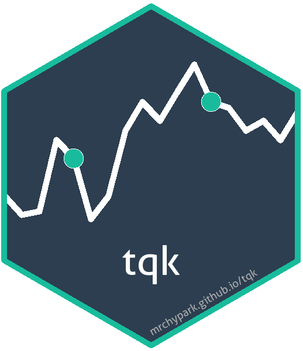

# tqk [](https://mrchypark.github.io/tqk/index.html)

<!-- badges: start -->
[](https://lifecycle.r-lib.org/articles/stages.html#stable)
[](https://app.codecov.io/gh/mrchypark/tqk?branch=main)
[](https://github.com/mrchypark/tqk/actions/workflows/check-standard.yaml)
[](https://CRAN.R-project.org/package=tqk)
[](https://mrchypark.r-universe.dev/tqk)
[](#contributors)

<!-- badges: end -->

## Installation

``` r
# CRAN version
install.packages("tqk")

# Dev version
install.packages('tqk', repos = c(
                     'https://mrchypark.r-universe.dev',
                     'https://cloud.r-project.org'
                 ))
```

## How to use

`{tqk}` now uses KRX OPEN API endpoints as source. For production API
calls, set your key first:

``` r
Sys.setenv(KRX_AUTH_KEY = "YOUR_KRX_AUTH_KEY")
```

### Stock code

`code_get()` function provide stock code.

``` r
code_get()
```

    ## # A tibble: 2,641 × 6
    ##    market name           code   name_full              name_eng        code_full
    ##    <chr>  <chr>          <chr>  <chr>                  <chr>           <chr>    
    ##  1 KOSDAQ 마이크로컨텍솔 098120 (주)마이크로컨텍솔루션 Micro Contact … KR709812…
    ##  2 KOSDAQ 스카이이앤엠   131100 (주)스카이이앤엠       SKY E&M Co., L… KR713110…
    ##  3 KOSDAQ 포스코엠텍     009520 (주)포스코엠텍         POSCO M-TECH C… KR700952…
    ##  4 KOSPI  AJ네트웍스     095570 AJ네트웍스보통주       AJ Networks Co… KR709557…
    ##  5 KOSPI  AK홀딩스       006840 AK홀딩스보통주         AK Holdings, I… KR700684…
    ##  6 KOSPI  BGF리테일      282330 BGF리테일보통주        BGF Retail      KR728233…
    ##  7 KOSPI  BGF            027410 BGF보통주              BGF             KR702741…
    ##  8 KOSPI  BNK금융지주    138930 BNK금융지주보통주      BNK Financial … KR713893…
    ##  9 KOSPI  BYC우          001465 BYC1우선주             BYC(1P)         KR700146…
    ## 10 KOSPI  BYC            001460 BYC보통주              BYC             KR700146…
    ## # ℹ 2,631 more rows

If want to get current version of stock code, add `fresh = TRUE`.

``` r
code_get(fresh = TRUE, sample = TRUE, bas_dd = "2024-01-02")
```

    ## # A tibble: 2,746 × 6
    ##    market name           code   name_full              name_eng        code_full
    ##    <chr>  <chr>          <chr>  <chr>                  <chr>           <chr>    
    ##  1 KOSDAQ 마이크로컨텍솔 098120 (주)마이크로컨텍솔루션 Micro Contact … KR709812…
    ##  2 KOSDAQ 포스코엠텍     009520 (주)포스코엠텍         POSCO M-TECH C… KR700952…
    ##  3 KOSPI  AJ네트웍스     095570 AJ네트웍스보통주       AJ Networks Co… KR709557…
    ##  4 KOSPI  AK홀딩스       006840 AK홀딩스보통주         AK Holdings, I… KR700684…
    ##  5 KOSPI  BGF리테일      282330 BGF리테일보통주        BGF Retail      KR728233…
    ##  6 KOSPI  BGF            027410 BGF보통주              BGF             KR702741…
    ##  7 KOSPI  BNK금융지주    138930 BNK금융지주보통주      BNK Financial … KR713893…
    ##  8 KOSPI  BYC우          001465 BYC1우선주             BYC(1P)         KR700146…
    ##  9 KOSPI  BYC            001460 BYC보통주              BYC             KR700146…
    ## 10 KOSPI  CJ우           001045 CJ1우선주              CJ(1P)          KR700104…
    ## # ℹ 2,736 more rows

### Stock data

`tqk_get()` function provide stock data through KRX OPEN API.
For real endpoints, set `KRX_AUTH_KEY`; for testing, you can use
`sample = TRUE`.

``` r
ss <- tqk_get(
  x = "088980",
  from = "2024-01-02",
  to = "2024-01-05",
  sample = TRUE
)
ss
```

    ## # A tibble: 4 × 6
    ##    date        open  high   low close   volume
    ##    <date>     <int> <int> <int> <int>    <int>
    ##  1 2024-01-02 12400 12530 12300 12510 1436093
    ##  2 2024-01-03 12490 12610 12460 12570 1286995
    ##  3 2024-01-04 12530 12570 12410 12420  563036
    ##  4 2024-01-05 12450 12490 12350 12390  405719

## Built-in dataset

`{tqk}` has built-in dataset called `SHANK` that is data to `2017-09-07`
with Samsung Elect, Hyundai Motor, Amore pacific, Naver, Kakao.

``` r
SHANK %>%
  dplyr::distinct(symbol)
```

    ## # A tibble: 5 × 1
    ##   symbol
    ##   <chr> 
    ## 1 SS    
    ## 2 HYD   
    ## 3 AMP   
    ## 4 NVR   
    ## 5 KKO

``` r
SHANK
```

    ## # A tibble: 22,259 × 7
    ##    symbol date          open    high     low   close volume
    ##    <chr>  <date>       <int>   <int>   <int>   <int>  <int>
    ##  1 SS     2017-09-07 2350000 2411000 2350000 2406000 193530
    ##  2 SS     2017-09-06 2338000 2359000 2335000 2350000 216221
    ##  3 SS     2017-09-05 2312000 2345000 2298000 2338000 234322
    ##  4 SS     2017-09-04 2289000 2318000 2275000 2302000 158870
    ##  5 SS     2017-09-01 2323000 2332000 2315000 2324000 212834
    ##  6 SS     2017-08-31 2311000 2332000 2300000 2316000 220234
    ##  7 SS     2017-08-30 2319000 2320000 2298000 2310000 150260
    ##  8 SS     2017-08-29 2282000 2304000 2258000 2304000 252473
    ##  9 SS     2017-08-28 2351000 2362000 2298000 2305000 199242
    ## 10 SS     2017-08-25 2394000 2394000 2336000 2351000 224871
    ## # ℹ 22,249 more rows

## Contributors ✨

Thanks goes to these wonderful people ([emoji key](https://allcontributors.org/docs/en/emoji-key)):

<!-- ALL-CONTRIBUTORS-LIST:START - Do not remove or modify this section -->
<!-- prettier-ignore-start -->
<!-- markdownlint-disable -->
<table>
  <tr>
    <td align="center"><a href="https://chulhongsung.github.io/"><br /><sub><b>SungChul Hong</b></sub></a><br /><a href="#question-chulhongsung" title="Answering Questions">💬</a></td>
    <td align="center"><a href="https://gbkim01.github.io/myblog/"><br /><sub><b>gbkim01</b></sub></a><br /><a href="https://github.com/mrchypark/tqk/issues?q=author%3Agbkim01" title="Bug reports">🐛</a></td>
  </tr>
</table>

<!-- markdownlint-enable -->
<!-- prettier-ignore-end -->
<!-- ALL-CONTRIBUTORS-LIST:END -->

This project follows the [all-contributors](https://github.com/all-contributors/all-contributors) specification. Contributions of any kind welcome!
